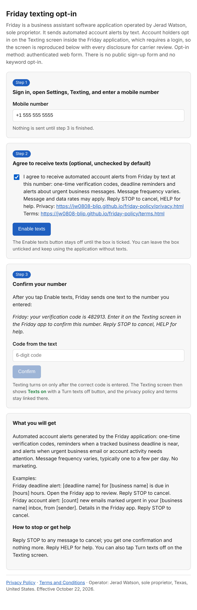

# Friday texting opt-in

Friday is a business assistant software application operated by Jerad Watson, sole proprietor. It sends automated account alerts by text. Account holders opt in on the Texting screen inside the Friday application, which requires a login, so the screen is reproduced here with every disclosure for carrier review. Opt-in method: authenticated web form. There is no public sign-up form and no keyword opt-in.

Rendered page: https://jw0808-blip.github.io/friday-policy/sms-signup.html
Screenshots: https://jw0808-blip.github.io/friday-policy/sms-signup-screenshot.png (consent box ticked) and https://jw0808-blip.github.io/friday-policy/sms-signup-screenshot-default.png (default, unticked)

## Step 1. Sign in, open Settings, Texting, and enter a mobile number

Mobile number: `+1 555 555 5555`

Nothing is sent until step 3 is finished.

## Step 2. Agree to receive texts (optional, unchecked by default)

☐ I agree to receive automated account alerts from Friday by text at this number: one-time verification codes, deadline reminders and alerts about urgent business messages. Message frequency varies. Message and data rates may apply. Reply STOP to cancel, HELP for help. Privacy: https://jw0808-blip.github.io/friday-policy/privacy.html Terms: https://jw0808-blip.github.io/friday-policy/terms.html

[ Enable texts ] (stays off until the box is ticked; the application works without texts)

## Step 3. Confirm your number

After tapping Enable texts, Friday sends one text to the number entered:

> Friday: your verification code is 482913. Enter it on the Texting screen in the Friday app to confirm this number. Reply STOP to cancel, HELP for help.

Code from the text: `6-digit code`  [ Confirm ]

Texting turns on only after the correct code is entered. The Texting screen then shows "Texts on" with a Turn texts off button, and the privacy policy and terms stay linked there.

## What you will get

Automated account alerts generated by the Friday application: one-time verification codes, reminders when a tracked business deadline is near, and alerts when urgent business email or account activity needs attention. Message frequency varies, typically one to a few per day. No marketing.

## How to stop or get help

Reply STOP to any message to cancel; you get one confirmation and nothing more. Reply HELP for help. You can also tap Turn texts off on the Texting screen.

Operator: Jerad Watson, sole proprietor, Texas, United States. Effective October 22, 2026.
